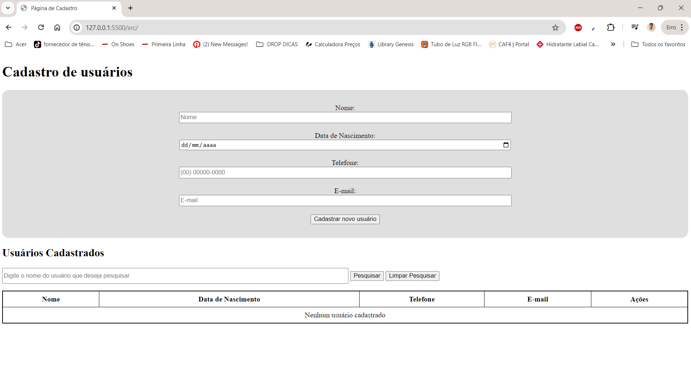
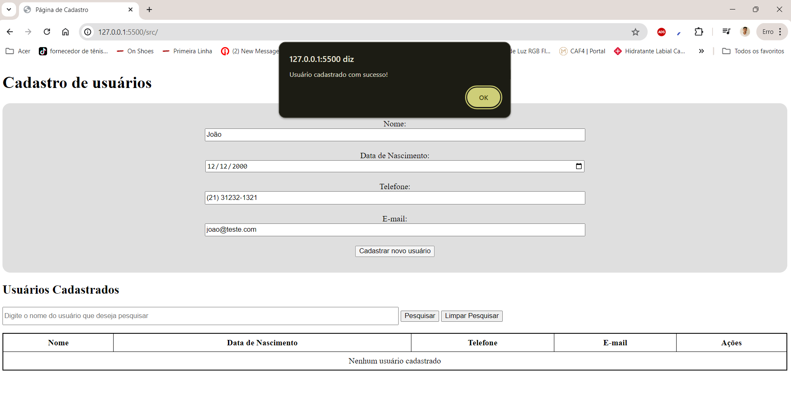
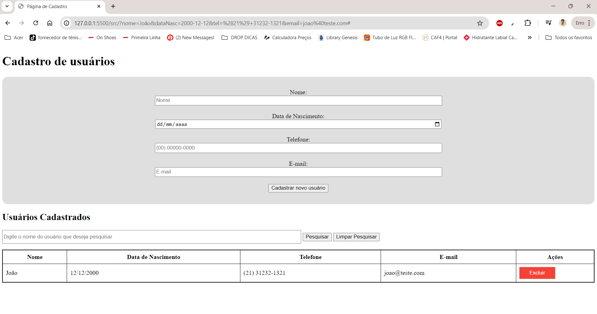
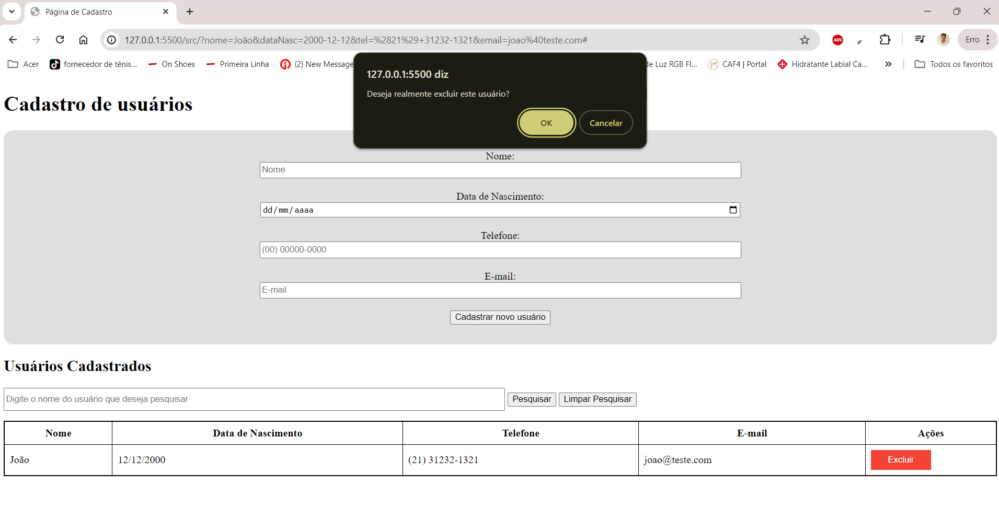
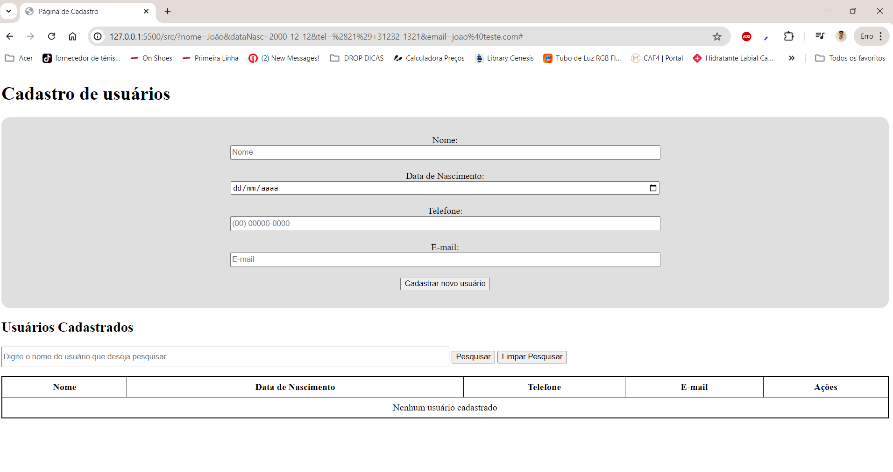
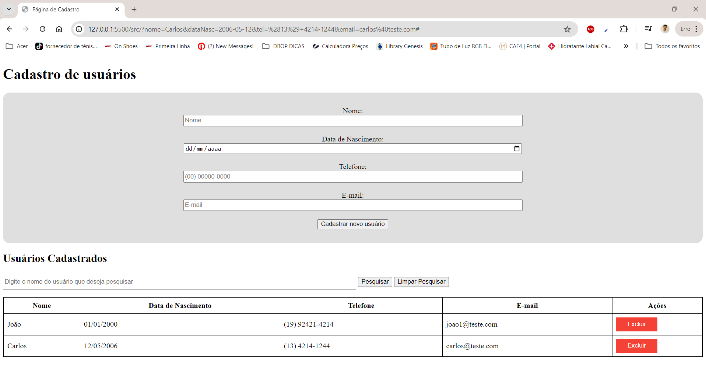
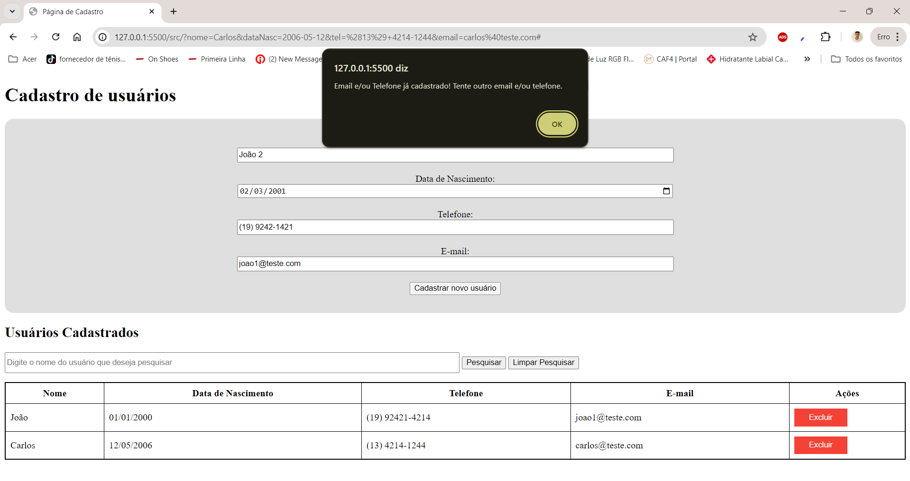

# Sistema de Cadastro de Usuários

Projeto-base desenvolvido em HTML, CSS e JavaScript para atividades práticas do **Minicurso de Git e GitHub – UFC Campus de Crateús**.

**Desenvolvedor original:** João Henrique de Oliveira.

## 1. Objetivo do Projeto

O projeto consiste em um sistema simples de cadastro de usuários, utilizando JavaScript e LocalStorage para armazenar e manipular as informações cadastradas.

A proposta é utilizar esse sistema como ponto de partida para atividades práticas de versionamento de código e colaboração, permitindo que os participantes explorem os recursos do Git e GitHub durante o minicurso.

## 2. Tecnologias Utilizadas

- HTML5
- CSS3
- JavaScript
- LocalStorage

## 3. Estrutura do Projeto

```text
projeto_base_minicurso/
├── README.md
├── .gitignore
└── src/
    ├── index.html
    └── assets/
        ├── images/
        ├── css/
        │   └── styles.css
        └── js/
            ├── classes/
            │   ├── userManager.js
            │   ├── userFactory.js
            │   └── user.js
            ├── utils/
            │   └── utils.js
            └── index.js
```

### Descrição dos principais arquivos

- **index.html:** contém a estrutura HTML da aplicação, incluindo o formulário de cadastro e a tabela de usuários.
- **styles.css:** responsável pela estilização e aparência da interface.
- **index.js:** concentra a lógica de manipulação da DOM e os eventos da aplicação.
- **userFactory.js:** responsável pela criação de usuários utilizando o padrão Factory Method.
- **userManager.js:** realiza o gerenciamento dos usuários, incluindo consultas, filtros, inserções e exclusões.
- **user.js:** define os atributos e métodos relacionados aos usuários.
- **utils.js:** reúne funções auxiliares utilizadas em diferentes partes do sistema.
- **images/:** contém imagens utilizadas na documentação do projeto.

## 4. Funcionalidades

Atualmente, o sistema disponibiliza as seguintes funcionalidades:

- Cadastro de usuários;
- Exclusão de usuários;
- Pesquisa e filtragem de usuários pelo nome;
- Validação de idade mínima de 18 anos;
- Verificação de e-mails e telefones duplicados.

## 5. Como Executar o Projeto

Para utilizar o sistema, siga as etapas abaixo:

**1. Clone o repositório:**

```bash
git clone https://github.com/laryssaszz/projeto_base_minicurso.git
```

**2. Entre na pasta do projeto:**

```bash
cd projeto_base_minicurso
```

**3. Acesse a pasta `src` e abra o arquivo `index.html` no navegador.**

Não é necessário instalar dependências ou configurar um banco de dados para executar a aplicação.

## 6. Demonstração do Sistema

### 6.1. Tela Inicial

Ao abrir o sistema, será exibida a interface principal, onde é possível realizar as operações de cadastro, exclusão e pesquisa de usuários.



### 6.2. Cadastro de Usuários

Para cadastrar um usuário, basta preencher todos os campos obrigatórios e clicar no botão de cadastro.

**Regras de validação:**
- O e-mail deve ser único;
- O telefone deve ser único;
- O usuário deve ter pelo menos 18 anos.

Após o preenchimento correto das informações, o sistema exibirá uma mensagem de confirmação.



Em seguida, o usuário será adicionado à tabela de registros.



### 6.3. Exclusão de Usuários

Para excluir um usuário, basta clicar no botão correspondente à exclusão na linha do registro desejado.

O sistema solicitará uma confirmação antes de realizar a operação.



Após confirmar, o usuário será removido da tabela.



Caso a operação seja cancelada, nenhum dado será removido.

### 6.4. Pesquisa de Usuários

O sistema também permite pesquisar usuários pelo nome.

Basta digitar o nome desejado no campo de pesquisa e clicar em **Pesquisar**. Os registros correspondentes serão exibidos na tabela.



Para visualizar novamente todos os registros, basta utilizar a opção de limpar pesquisa.

### 6.5. Mensagens de Erro e Validações

O sistema possui algumas validações para evitar cadastros incorretos.

Entre as situações verificadas estão:

- Tentativa de cadastro de usuários menores de 18 anos;
- Tentativa de utilização de e-mail já cadastrado;
- Tentativa de utilização de telefone já cadastrado.

Quando alguma dessas situações ocorre, o sistema apresenta uma mensagem informando o problema.



---

## 7. Proposta de Utilização no Minicurso

Este projeto será utilizado como base para as atividades práticas do minicurso de Git e GitHub.

A partir da estrutura existente, os participantes poderão realizar modificações, adicionar funcionalidades e trabalhar de forma colaborativa, praticando os principais recursos de versionamento de código.

**Atividades sugeridas:**

- Criar repositórios e realizar commits;
- Criar e utilizar branches;
- Desenvolver novas funcionalidades;
- Abrir Pull Requests;
- Simular e resolver conflitos de mesclagem (*merge conflicts*).

O objetivo é proporcionar uma experiência prática com o fluxo de versionamento e colaboração utilizado no desenvolvimento de software.
